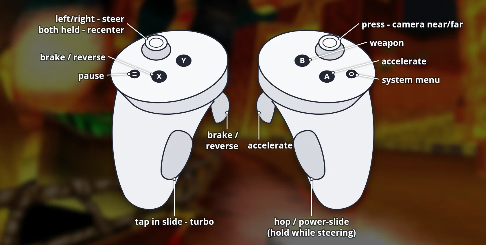

# CTR: Turbocharged VR (Meta Quest)

**Download, install guide, controls and pictures: [portroyale.online/ctr-turbocharged.html](https://portroyale.online/ctr-turbocharged.html)**

Crash Team Racing: Turbocharged running natively on Meta Quest (tested on
Quest 3), built from this repository's `quest` branch: the upstream 64-bit
branch plus a GLES renderer path and an OpenXR layer. Races are in real 3D
around you with head tracking; menus show on a large virtual screen.

## What you need

- Your own **NTSC-U (US) Crash Team Racing** disc image as a raw `.bin`
  (SCUS-94426). Game data is not included.
- The APK from the [Releases](https://github.com/SgtBilko76/CTR-Turbocharged-VR/releases)
  page (or your own build, see below).

## Install

1. Install the APK (SideQuest, or `adb install -r CTR-Turbocharged-VR-v0.1.0.apk`).
2. Copy the disc image to the headset as `/sdcard/CTR/assets/ctr-u.bin`
   (in SideQuest: the folder icon, then `CTR/assets`).
3. Start **CTR Turbocharged VR** from Library > Unknown Sources. On the first
   start the Quest asks for file access: allow it, then start the app again.

Saves, `config.ini` and the log file are kept in `/sdcard/CTR`.

## 3D view

Races (and every other 1-player 3D scene, like the Adventure hub) are drawn
in stereo around you: you sit at the game's chase camera and can look around
freely. The race HUD floats on a panel in front of you. Menus and
split-screen modes use the flat virtual screen. Hold both stick clicks for
1 second to recentre the view.

The 3D view needs the game's native 3D renderer, so the game's renderer
option is switched to native while `stereo=1`.

## Controls



The Touch controllers act as a PlayStation pad; the game's own controller
options can remap everything.

| Touch | PlayStation | In a race (default) |
|---|---|---|
| Right trigger | Cross | accelerate |
| Left trigger | Square | brake / reverse |
| A | Cross | accelerate, confirm in menus |
| B | Circle | weapon, back in menus |
| X | Square | brake / reverse |
| Y | Triangle | |
| Right grip | R1 | hop / power-slide (hold while steering) |
| Left grip | L1 | hop; tap during a power-slide for a turbo boost |
| Left stick | analog stick | steer |
| Right stick | D-pad | menus |
| Right stick click | L2 | camera near / far |
| Left stick click | Select | |
| Menu button (left) | Start | pause |

Hold **both stick clicks for one second** to put the screen back in front of you.

## Settings (optional)

`/sdcard/CTR/vr.cfg`, one `key = value` per line:

| Key | Default | Meaning |
|---|---|---|
| `screen_width` | 3.0 | screen width in metres |
| `screen_distance` | 2.4 | distance from your head in metres |
| `screen_height` | 0.0 | metres above eye level |
| `refresh_rate` | 120 | display refresh rate (72, 80, 90, 120) |
| `screen_pixels_w` / `screen_pixels_h` | 1920 / 1080 | game resolution |
| `steer_deadzone` | 0.08 | stick travel ignored around the centre |
| `steer_full` | 0.80 | stick travel for full steering (lower = more sensitive) |
| `stereo` | 1 | 1 = races and the Adventure hub in 3D around you, 0 = always the flat screen |
| `world_scale` | 64 | game units per metre (lower = the world looks bigger) |
| `cull_fov` | 120 | vertical degrees the game draws around the camera (room for head turns) |
| `level_horizon` | 1 | 1 = keep the horizon level, 0 = follow the chase camera's pitch and roll |
| `eye_scale` | 0.9 | eye resolution relative to the headset's recommended size |
| `hud_distance` / `hud_width` / `hud_height` | 2.0 / 2.6 / -0.1 | race HUD panel in metres |

## Building

```
cd android
JAVA_HOME=<JDK 17> ./gradlew assembleDebug
```

Needs the Android SDK with NDK 25.1 and CMake 3.22.1. `tools/quest/quest_run.sh`
builds, installs, pushes the disc image, launches and records the log;
`tools/quest/quest_cmd.sh` sends pad presses for headless tests.

Desktop checks of the Quest code paths:
`cmake -B build-gles -DCTR_NATIVE_64BIT=ON -DCTR_NATIVE_GLES=ON -DCTR_QUEST_DESKTOP_TEST=ON`
renders through the same GLES path and window hooks as the headset.
